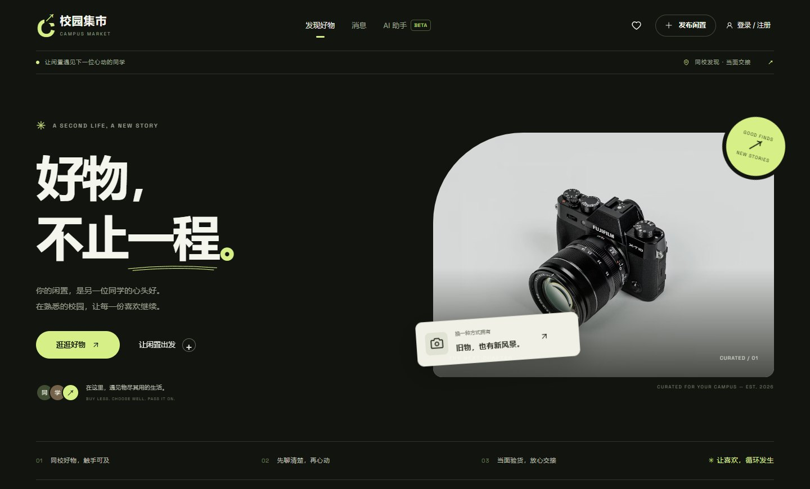
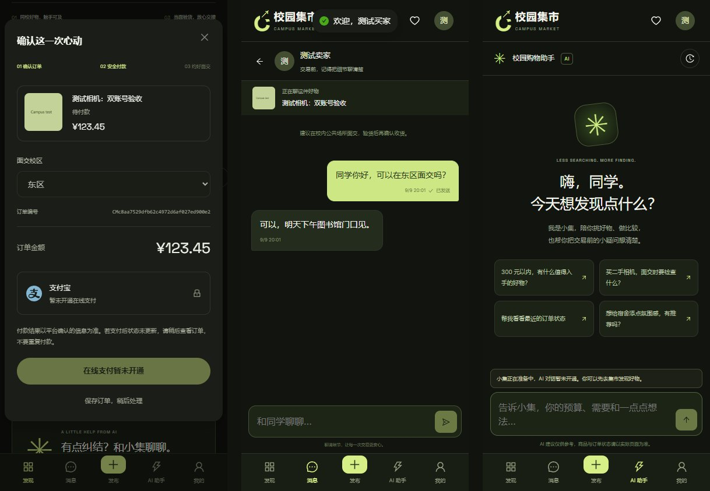
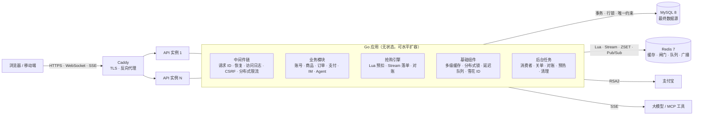
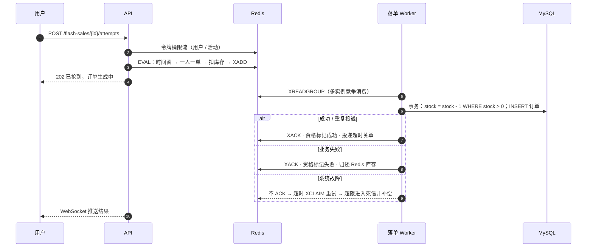

<div align="center">



<h1>校园集市 · Campus Market</h1>

<p><b>面向高校的二手交易平台：商品交易、即时通讯、限时抢购、AI 导购</b><br/>
Go 模块化单体 · MySQL 8 · Redis 7 · React 19</p>

<p>
<a href="https://github.com/malevrigns/campus-market/actions/workflows/ci.yml"></a>


</p>

<p>
<a href="docs/architecture.md">架构设计</a> ·
<a href="docs/api.md">API 文档</a> ·
<a href="docs/production-readiness.md">部署与运维</a> ·
<a href="docs/interview.md">设计问答</a>
</p>

</div>

---

## 目录

- [项目简介](#项目简介)
- [核心指标](#核心指标)
- [功能概览](#功能概览)
- [系统架构](#系统架构)
- [技术亮点](#技术亮点)
- [技术栈](#技术栈)
- [快速开始](#快速开始)
- [测试与质量保障](#测试与质量保障)
- [项目结构](#项目结构)
- [部署](#部署)
- [路线图与已知边界](#路线图与已知边界)

## 项目简介

校园集市让同学们在熟悉的校园里买卖闲置：发布商品、即时沟通、当面验货、在线支付；社团义卖、毕业季清仓等场景可以发起**限时抢购**；AI 助手帮你按预算找好物、查订单。

后端采用**模块化单体**：一个无状态 Go 进程承载全部业务模块，依赖 MySQL（最终数据源）与 Redis（缓存、闸门、队列、广播）。所有跨实例协作——实时推送、缓存失效、定时任务、发号——都经由 Redis 完成，服务可以直接水平扩容。在当前规模下不拆分微服务，避免分布式事务与运维成本；唯一需要独立扩缩的抢购落库已经通过消息流与请求链路解耦，后续可以单独部署。

## 核心指标

| 指标 | 结果 | 说明 |
|:--|:--|:--|
| 抢购正确性 | **0 超卖 · 一人一单** | 3000 个并发用户抢 200 件，200 单全部落库，DB 与 Redis 剩余库存均为 0 |
| 抢购入口吞吐 | **≈ 1,560 req/s** | 含会话校验与三级限流；P50 122 ms · P99 210 ms |
| 服务端资源 | **≈ 0.2 核** | 压测期间 CPU profile；瓶颈在同机的数据库与压测端 |
| 自动化测试 | **79 个测试用例** | 真实 MySQL + Redis 集成测试，`go test -race` 全量通过 |

> 压测环境：2 vCPU / 7 GB，MariaDB 11.4、Redis 7.0、服务端与压测工具运行在同一台机器上。复现方式见 [测试与质量保障](#测试与质量保障)。

## 功能概览

| 模块 | 能力 |
|:--|:--|
| **账号** | 邮箱 / 手机验证码注册，密码或验证码登录，找回密码，联系方式绑定；bcrypt 存储；HttpOnly 会话 |
| **商品** | 发布、图片上传（重新编码去除 EXIF）、搜索、分类 / 校区筛选、排序、游标分页、收藏、下架、热门榜 |
| **订单** | 服务端定价与库存预占、接口幂等、15 分钟自动关单、面交 / 确认收货状态机、退款申请、事件审计 |
| **支付** | 支付宝电脑网站 / 手机网站支付，RSA2 验签、金额与商户校验、回调去重、主动查单对账 |
| **限时抢购** | 活动预热、服务器时间倒计时、Redis 原子预扣、异步落单、结果推送、超时归还库存 |
| **即时通讯** | 买卖双方会话、消息序号与客户端去重、未读水位、断线补拉、多实例 WebSocket 推送、在线状态 |
| **AI 助手** | 动态 Agent 工作室、模型 / 工具 / MCP 能力目录、版本发布与回滚、SSE 流式多轮对话 |
| **界面** | 桌面 / 移动端自适应，明暗主题，悬浮 AI 助手 |

<div align="center">

<p><sub>移动端：确认订单 · 买卖双方聊天 · AI 导购助手</sub></p>
</div>

## 系统架构



限时抢购的同步链路只访问 Redis，订单异步写入数据库：



更多链路（下单、关单、缓存、会话、IM 推送）与数据模型见 [docs/architecture.md](docs/architecture.md)。

后端按 `transport/http → service → port → repository/adaptor` 分层，事务边界、能力契约与扩展影响矩阵见 [docs/refactor.md](docs/refactor.md)；
机器可读接口契约见 [docs/openapi.yaml](docs/openapi.yaml)。

## 技术亮点

<table>
<tr><td width="22%"><b>限时抢购</b><br/><code>internal/service/flash.go · internal/repository/redis/flash.go</code></td><td>
Lua 原子完成"时间窗校验 → 一人一单 → 扣减库存 → 写入 Stream"，同步链路不访问数据库；订单号在入队前预生成，重复消费以主键冲突识别，天然幂等；PEL 超时 <code>XCLAIM</code> 重投，超过投递上限进入死信流并补偿；数据库条件扣减与 <code>UNIQUE(flash_sale_id, buyer_id)</code> 兜底；定时对账（连续两轮一致才用 CAS 修正）；Stream 只裁剪已全部确认的前缀。
</td></tr>
<tr><td><b>多级缓存</b><br/><code>internal/pkg/cache</code></td><td>
分段锁 LRU（L1）+ Redis（L2）Cache-Aside。singleflight 合并回源防击穿，空值缓存防穿透，TTL 随机抖动防雪崩；先更新数据库再删缓存并延迟双删；Pub/Sub 广播清理其他实例的本地缓存；Redis 故障自动降级回源。
</td></tr>
<tr><td><b>可靠延迟队列</b><br/><code>internal/pkg/delayqueue</code></td><td>
ZSET + Lua 原子领取，可见性超时重投，指数退避，死信集合；替代原来每 30 秒的全表扫描关单，保留每分钟一次的兜底扫描保证最终一致。
</td></tr>
<tr><td><b>分布式锁</b><br/><code>internal/pkg/lock</code></td><td>
<code>SET NX PX</code> + Lua 校验 token 释放 / 续期，看门狗自动续约，锁丢失时取消业务 context，提供单调递增的 fencing token；用于"多实例只需一个执行"的定时任务与雪花节点租约。
</td></tr>
<tr><td><b>分布式限流</b><br/><code>internal/pkg/ratelimit</code></td><td>
滑动窗口（登录、验证码等敏感接口）与令牌桶（全局 IP、抢购入口）两种 Lua 实现，统一使用 Redis 时钟；Redis 不可用时降级为进程内限流，避免限流组件拖垮全站。
</td></tr>
<tr><td><b>MySQL 设计</b><br/><code>migrations/0001_init.sql</code></td><td>
条件更新 + 行锁防超卖；唯一键实现接口幂等（先插入、冲突再查，避免间隙锁死锁）；生成列 <code>listed</code> 让列表排序走索引；游标分页解决深分页；<code>OR</code> 改写为 <code>UNION ALL</code>；死锁 / 锁等待自动重试；迁移用 <code>GET_LOCK</code> 保证多实例互斥。
</td></tr>
<tr><td><b>即时通讯</b><br/><code>internal/service/chat.go</code></td><td>
会话行锁内分配消息序号，并发发送不重不漏；推拉结合（推送信号、按序号拉取）；Redis Pub/Sub 跨实例投递；心跳维护在线状态。
</td></tr>
<tr><td><b>会话与发号</b></td><td>
会话缓存吊销时写入墓碑、回填使用 <code>SET NX</code>，杜绝已退出的会话被缓存复活；雪花订单号修复了时钟回拨导致的重复 ID，节点号由 Redis 租约自动分配。
</td></tr>
</table>

每项设计的取舍、替代方案与故障处理，整理在 [docs/interview.md](docs/interview.md)。

## 技术栈

| 层次 | 选型 |
|:--|:--|
| 语言与运行时 | Go 1.26（标准库 `net/http` 路由 + 自研中间件链），`log/slog` 结构化日志，pprof |
| 数据存储 | MySQL 8.4（InnoDB），go-sql-driver/mysql；内嵌 SQL 迁移 |
| 缓存与中间件 | Redis 7.4（Lua、Stream 消费组、ZSET、Pub/Sub、HyperLogLog），go-redis v9 |
| 实时通信 | WebSocket（coder/websocket）、Server-Sent Events |
| 前端 | React 19、Ant Design 5、Vite 6、Playwright |
| 部署 | Docker 多阶段构建、Docker Compose、Caddy 自动 HTTPS、GitHub Actions |

## 快速开始

**前置条件**：Docker、Go 1.26、Node.js 22。

```bash
# 1. 启动 MySQL 与 Redis
docker compose -f compose.dev.yaml up -d --wait

# 2. 启动后端（首次启动自动建表，并写入演示商品）
cd backend && make run

# 3. 启动前端（新终端）
cd frontend && npm ci && npm run dev
```

打开 <http://127.0.0.1:5173>。本地模式下验证码直接显示在页面上，注册两个账号即可体验发布、聊天、下单。

<details>
<summary><b>Windows PowerShell</b></summary>

```powershell
docker compose -f compose.dev.yaml up -d --wait

cd backend
$env:DATABASE_DSN = 'campus:campus@tcp(127.0.0.1:3306)/campus'
$env:REDIS_ADDR = '127.0.0.1:6379'
$env:SEED_DEMO = 'true'
$env:AUTH_DELIVERY_MODE = 'local'
go run ./cmd/server
```

</details>

<details>
<summary><b>体验限时抢购</b></summary>

1. 登录后访问 <http://127.0.0.1:5173/api/v1/auth/me>，记下自己的用户 `id`；
2. 以 `ADMIN_USER_IDS=<id>` 重启后端；
3. 进入「限时抢购」→「发起活动」，再切换到其他账号抢购。

</details>

主要环境变量见 [backend/README.md](backend/README.md)。

## 测试与质量保障

```bash
cd backend
make test     # gofmt / vet + 集成测试（-race），自动启动依赖
make bench    # 抢购压测与一致性校验
```

集成测试为每个用例创建独立数据库（`campus_t_*`）和独立 Redis 前缀，可并行执行、互不干扰，结束后自动清理。

| 类别 | 覆盖内容 |
|:--|:--|
| 并发正确性 | 400 人抢 50 件不超卖、并发下单只成交一单、并发发消息序号连续、限流脚本原子性、锁互斥 |
| 故障场景 | 消费者崩溃后重投、毒消息进入死信、重复投递幂等、Redis 资格丢失补偿、库存对账、锁丢失、Redis 不可用降级 |
| 分布式 | 两个应用实例共享 MySQL / Redis 时的 WebSocket 跨实例推送、缓存跨实例失效、雪花节点租约互斥 |
| 业务流程 | 越权访问、金额篡改、支付回调验签与重放、回调丢失后的主动查单、Agent 权限与撤销 |
| 端到端 | Playwright 双账号浏览器验收（上传、聊天、下单、取消） |

CI（GitHub Actions）在 MySQL 8.4 + Redis 7.4 服务容器中运行格式检查、静态检查与完整测试，并实际启动服务跑一轮抢购压测，出现超卖或一人多单即判定失败。

<details>
<summary><b>压测工具输出示例</b></summary>

```text
=== flash attempt load ===
requests 3000 in 1.919s  ->  1563 req/s
latency  p50=121.99ms p90=159.01ms p99=210.27ms max=254.00ms
status   map[202:200 409:2800]  (202=抢到排队中 409=售罄 429=限流削峰)

=== consistency ===
winners 200  orders 200  stock 200  db_stock_left 0  redis_stock_left 0  multi_order_users 0
all orders persisted after 2.122s
result: PASS (no oversell, one order per user)
```

</details>

## 项目结构

```text
campus-market
├── backend
│   ├── cmd
│   │   ├── server            应用入口：配置 → 迁移 → 组装 → 后台任务 → HTTP，优雅退出
│   │   ├── flashbench        抢购压测与一致性校验
│   │   └── testfixture       端到端测试数据准备
│   └── internal
│       ├── config            环境变量配置与校验
│       ├── infra             MySQL（连接池、迁移、事务重试）、Redis
│       ├── pkg               缓存 · 分布式锁 · 限流 · 延迟队列 · 雪花 ID
│       ├── seckill           限时抢购引擎
│       ├── platform          HTTP 与业务模块
│       └── testenv           集成测试环境
├── frontend                  React 19 + Ant Design
├── deploy                    Caddy、MySQL 初始化脚本
├── docs                      架构、API、运维、设计问答
├── compose.yaml              生产编排：Caddy + API + MySQL + Redis
└── compose.dev.yaml          本地开发依赖
```

## 部署

```bash
cp .env.example .env    # 填写 DOMAIN、MYSQL_PASSWORD、MYSQL_ROOT_PASSWORD、REDIS_PASSWORD
docker compose up -d --build
docker compose ps
```

Caddy 自动签发 HTTPS 证书；MySQL、Redis 与上传目录使用持久卷，均不对公网暴露端口。Redis 开启 AOF 并使用 `noeviction` 策略，避免库存与队列数据被淘汰。备份、扩容与监控见 [docs/production-readiness.md](docs/production-readiness.md)。

## 路线图与已知边界

- [x] MySQL + Redis 存储与可水平扩容的无状态服务
- [x] 限时抢购、多级缓存、延迟队列、分布式锁与限流
- [x] 多实例实时推送与在线状态
- [ ] Prometheus 指标与 OpenTelemetry 链路追踪
- [ ] Redis Sentinel / Cluster（Cluster 下活动相关 key 需使用 hash tag）
- [ ] 中文全文检索（MySQL ngram 或 Elasticsearch）
- [ ] 退款执行与审核后台、卖家结算
- [ ] 群聊、图片消息、RAG 知识库

支付需要真实商户资质联调，AI 助手需要配置模型服务，二者未配置时接口明确返回不可用，不会模拟成功。完整的生产差距说明见 [docs/production-readiness.md](docs/production-readiness.md)。
