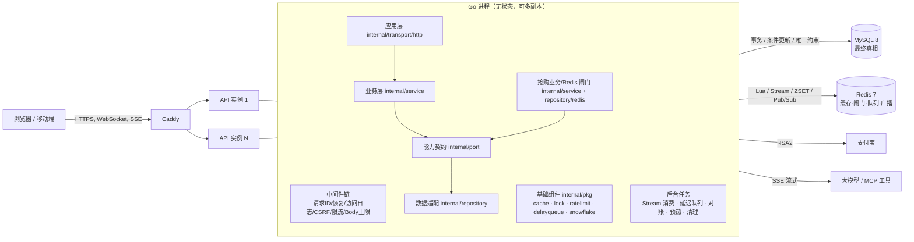
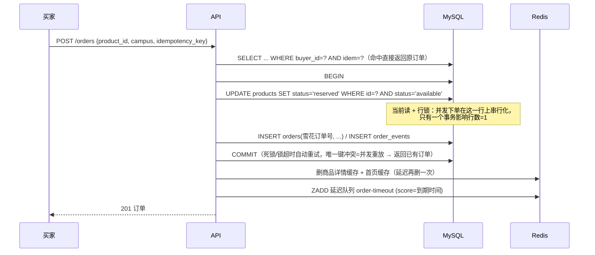
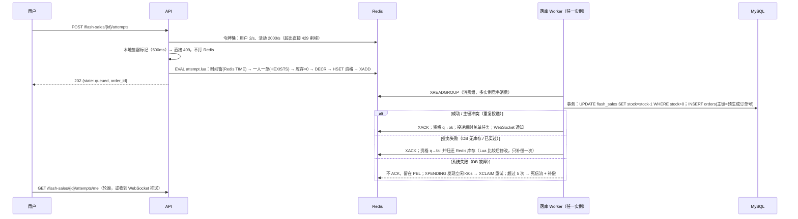

# 架构设计

校园集市是一个**模块化单体**（modular monolith）：一个 Go 进程包含身份、商品、订单、支付、IM、限时抢购和 AI 助手，
依赖 MySQL 8 与 Redis 7。进程本身无状态，可以水平扩容为多个副本——跨实例需要协调的部分（推送、缓存失效、定时任务、发号）都经过 Redis。

没有拆微服务的原因：团队规模和业务量都不需要；单体内的模块边界（包、接口、表）已经清晰，
真正需要独立扩缩的只有抢购落库 worker，而它已经通过 Redis Stream 与请求链路解耦，将来要拆也只需把 `FlashService.Run` 放到独立进程。
本次后端已按“应用层 → 业务层 → 能力契约 → 数据适配器”重构，详见 [refactor.md](refactor.md)。



## 目录

```text
backend/
  cmd/server        应用入口：配置 → MySQL(等待就绪+迁移) → Redis → 组装 → 后台任务 → HTTP；优雅退出
  cmd/flashbench    抢购压测 + 一致性校验工具
  cmd/testfixture   E2E 测试库初始化（只允许 campus_e2e* 库）
  internal/config   环境变量配置与校验
  internal/infra/mysqlx   连接池参数、内嵌迁移(GET_LOCK 互斥)、死锁重试事务、错误码判断、LIKE 转义
  internal/infra/redisx   客户端参数、key 前缀
  internal/pkg/cache      L1 分段 LRU + L2 Redis；singleflight、空值缓存、TTL 抖动、延迟双删、Pub/Sub 失效
  internal/pkg/lock       分布式锁：SET NX PX + Lua 校验释放/续期 + 看门狗 + fencing token
  internal/pkg/ratelimit  Redis Lua 滑动窗口 / 令牌桶，Redis 故障降级为本地限流
  internal/pkg/delayqueue ZSET 可靠延迟队列：原子领取、可见性超时重投、指数退避、死信
  internal/pkg/snowflake  雪花 ID（修复时钟回拨重复 bug），节点号用 Redis 租约分配
  internal/domain         业务实体、枚举、值对象与业务错误
  internal/port           业务层依赖的能力契约（仓储/事务/缓存/推送/支付/验证码/LLM/MCP）
  internal/service        业务用例：身份、商品、订单、支付、IM、Agent、抢购、运行态
  internal/repository/mysql  MySQL：SQL、持久化模型映射、存储错误翻译
  internal/repository/redis  Redis：缓存、会话、在线状态、热度、抢购 Lua/Stream、推送
  internal/adaptor        支付宝、邮件/短信、OpenAI 兼容 LLM、MCP、图片存储
  internal/transport/http 应用层：路由、中间件、DTO、Cookie、响应/错误映射、SSE/WS
  internal/job            后台任务编排（每实例任务 + 分布式锁选主任务）
  internal/app            组合根：构造顺序、依赖注入、启动/关闭
  internal/testenv        集成测试：每个用例独立数据库 + 独立 Redis 前缀
```

## 数据模型与索引

完整 DDL 见 [`0001_init.sql`](../backend/internal/infra/mysqlx/migrations/0001_init.sql)。几个关键设计：

| 表 | 关键约束 / 索引 | 为什么 |
|---|---|---|
| `products` | 生成列 `listed = status IN ('available','reserved')`；`(listed, created_at, id)`、`(category, listed, created_at)` | 首页 `WHERE listed=1 ORDER BY created_at DESC` 等值前缀 + 有序，排序走索引不 filesort；`status IN (..)` 两个值时做不到 |
| `orders` | 主键 = 雪花订单号；`UNIQUE(buyer_id, idem)`；`UNIQUE(flash_sale_id, buyer_id)`；`(status, expires_at)` | 趋势递增主键顺序写入；幂等键与一人一单由数据库兜底；超时扫描走索引 |
| `orders` | `CHECK((product_id IS NULL) <> (flash_sale_id IS NULL))` | 一张订单要么来自二手商品，要么来自抢购活动 |
| `flash_sales` | `CHECK(stock >= 0 AND stock <= total_stock)` | 库存的数据库级不变量 |
| `messages` | `UNIQUE(conversation_id, seq)`；`UNIQUE(conversation_id, sender_id, client_msg_id)` | seq 不重复；客户端重发幂等 |
| `agent_runs` | 生成列 `running_user = IF(status='running', user_id, NULL)` + 唯一索引 | MySQL 没有部分索引，用"只有运行中才有值"的生成列实现"每人同时只有一个运行中任务" |
| `sessions` / `auth_codes` | 按过期时间索引，后台分批 `DELETE ... LIMIT 1000` | 不在登录路径上做范围删除（会与并发登录争抢间隙锁） |

所有表 `utf8mb4_bin`（ID、幂等键、令牌摘要大小写敏感），需要模糊搜索的标题/描述用 `utf8mb4_unicode_ci`。时间为毫秒时间戳 `BIGINT`。

## 核心链路

### 1. 普通下单（防超卖、幂等）



### 2. 限时抢购（业务见 `internal/service/flash.go`，Redis 闸门见 `internal/repository/redis/flash.go`）



一致性保障分三层：

1. **Redis Lua 是闸门**：单线程原子执行，同步链路不访问数据库，扛住瞬时流量；
2. **数据库是真相**：条件扣减 `stock>0` + `UNIQUE(flash_sale_id, buyer_id)`，即使 Redis 数据错乱也不会超卖或一人多单；
3. **对账兜底**：每 15 秒比较 `Redis 库存` 与 `DB 库存 - 排队中资格数`，连续两轮同样的偏差才用 CAS 修正（避免与正在落库的消息竞争误判）；Redis 数据整体丢失时从数据库重新预热。

Stream 不能用 `XADD MAXLEN` 截断（积压时会删掉未消费的订单），而是周期性计算"消费组已投递位置"与"PEL 最小 ID"的较小值，`XTRIM MINID` 只删除已全部确认的前缀。

### 3. 订单超时关单

原实现每 30 秒全表扫描。现在：

- 下单成功后 `ZADD dq:order-timeout:ready <到期时间> <订单号>`；
- 每个实例的消费者用 Lua 原子执行 `ZRANGEBYSCORE ready → ZREM ready → ZADD inflight(now+30s)`，多实例不会重复领取；
- 处理成功 `ZREM inflight`；进程崩溃时任务停在 inflight，可见性超时后被放回 ready；失败按指数退避重试，8 次后进入死信集合；
- 处理函数 `expireOrder` 幂等：`SELECT ... FOR UPDATE` 锁订单行，已支付/已取消直接返回；已打开支付通道的订单交给支付对账，避免"用户刚付款就被关单"；
- 每分钟一次的兜底扫描（分布式锁保证单实例执行，走 `(status, expires_at)` 索引）处理入队失败或 Redis 数据丢失的订单。

### 4. 分层与请求链

```text
HTTP 请求 → transport/http（绑定 DTO、身份、入口限流）
          → service（业务规则、用例、事务边界）
          → port（能力接口）
          → repository/mysql | repository/redis | adaptor/*
          → 响应 DTO / 领域错误 → transport/http 映射状态码
```

对象构造统一在 `internal/app`：基础设施 → 仓储/适配器 → 服务 → 路由 → 后台任务。
业务服务只依赖 `internal/port`，SQL 与 Redis 命令不下沉到 controller/service；
事务由服务层通过 `InTx` 决定边界，提交后的缓存失效、推送、延迟任务由服务层编排。

### 5. 缓存（Cache-Aside）

| 问题 | 手段 |
|---|---|
| 击穿：热点 key 过期瞬间并发回源 | `singleflight.DoChan` 合并同进程同 key 回源；回源使用脱离请求的 context，首个请求取消不影响其他等待者 |
| 穿透：查询不存在的数据 | 回源 `ErrNotFound` 时写入空值标记（30s） |
| 雪崩：大量 key 同时过期 | L2 TTL 加 0–20% 随机抖动 |
| 一致性：更新后读到旧值 | 先更新数据库再删缓存，500ms 后再删一次（延迟双删），覆盖"读请求在删除前读到旧值、删除后回填"的窗口 |
| 多实例 L1 不一致 | 删除时 Pub/Sub 广播，其他实例清理本地副本；广播可能丢失，L1 TTL 只有 3 秒兜底 |
| Redis 故障 | GET 失败直接回源数据库，不写回，计数 `Degraded` |

缓存对象：商品详情（10 分钟）、首页默认信息流（30 秒，任何商品变更都删除）、抢购活动元数据（30 秒）、活动列表（5 秒）、热榜（60 秒）、会话（30 秒，见下）。

### 6. 会话缓存与吊销

每个登录请求都要校验会话（原来是三表 JOIN）。现在先查 `sess:<token摘要>`：

- 回填使用 `SET NX`；退出登录/改密码时写入 `revoked` 墓碑（TTL 大于缓存 TTL）而不是 `DEL`；
- 这样"读请求刚从 DB 读到有效会话 → 用户退出 → 读请求回填缓存"的竞态中，回填因为墓碑存在而失败，已吊销的会话不会被缓存复活；
- 资料变更（绑定邮箱）则删除该用户全部会话缓存并延迟再删一次。

### 7. IM 多实例推送

- 消息 seq：`UPDATE conversations SET seq=seq+1`（拿会话行锁）→ 同事务读回 seq → `INSERT messages`。同一会话并发发送在行锁上排队，不重不漏；不同会话互不影响。
- 推送：WebSocket 只推"有新消息"信号，客户端按 seq 游标拉取（推拉结合，推送丢失不丢消息）。
  `LiveHub.Notify` 先投递本实例连接，再 `PUBLISH` 到 Redis；其他实例订阅后投递给自己持有的连接。慢消费者（缓冲区满）断开，客户端重连补拉。
- 在线状态：心跳刷新 `online:<uid>`（TTL 60s），会话列表 `MGET` 返回 `peer_online`。

### 8. 限流

| 位置 | 算法 | 阈值 |
|---|---|---|
| 所有接口 | 令牌桶 / IP | 50 req/s，突发 500（校园 NAT 场景放宽） |
| 登录/注册 | 滑动窗口 / IP | 30 次/分钟 |
| 验证码 | 滑动窗口 | 单号码 10/天、单 IP 60/小时、单通道 500/天（控制短信费用） |
| 下单 / 发消息 / 发布 / 上传 / AI | 滑动窗口 / 用户 | 60/分、120/分、60/时、15/分、10/分 |
| 抢购 | 令牌桶 / 用户 + 活动 | 2/s（突发 5）、2000/s（突发 4000） |

两个 Lua 脚本都用 `redis.call('TIME')` 取时间，避免多实例时钟偏差。Redis 不可用时降级为进程内固定窗口（fail-open + 单机兜底）。

### 9. 后台任务与分布式锁

| 任务 | 运行方式 |
|---|---|
| IM Pub/Sub、缓存失效订阅、延迟队列消费、抢购 Stream 消费 | 每个实例都运行（Redis 保证同一任务只被领取一次） |
| 兜底关单扫描（1 分钟）、支付对账（30 秒）、抢购对账（15 秒）、活动预热（1 分钟）、过期数据清理（10 分钟） | `lock.Run` 抢锁，只有一个实例执行；锁带看门狗续期，持有者宕机后 TTL 到期由其他实例接手 |

锁实现：`SET key token NX PX ttl`，Lua 比较 token 后 `DEL`/`PEXPIRE`；同时 `INCR` 一个围栏号（fencing token）。
被锁保护的任务本身都是幂等的，锁只用于减少重复劳动——正确性永远由数据库约束保证（Redis 主从切换可能丢锁）。

### 10. 雪花订单号

`41 位毫秒 + 10 位节点 + 12 位序列`。节点号不再手工配置，启动时用分布式锁在 `[0,1023]` 中抢占一个并持续续约；
修复了原实现"时钟回拨 ≤5ms 时沿用上次时间戳却不递增序列号"导致的重复 ID。

## 迁移与发布

- 迁移文件内嵌进二进制，启动时执行；多个实例同时启动时用 `GET_LOCK` 互斥，只有一个实例执行 DDL。
- MySQL DDL 会隐式提交，迁移不能放进事务；新增迁移应保持向后兼容（先加列/表，再发代码，最后清理旧列），保证滚动发布期间新旧版本共存。
- 优雅退出：`SIGTERM` → `http.Server.Shutdown` 等待在途请求 → 取消后台任务（正在处理的 Stream 消息用独立超时尽量完成，未完成的留在 PEL 由其他实例接手）→ 释放雪花节点租约。

## 已知边界

- Redis 是单节点/主从：主从切换可能丢失最近 1 秒写入（AOF everysec）。抢购库存、资格、队列都有数据库或对账兜底；但 Redis Cluster 下需要把同一活动的 key 和 Stream 用 hash tag 放进同一 slot 才能在 Lua 中一起操作。
- 搜索使用 `LIKE` + 筛选索引，适合校园规模；数据量上来后应换 MySQL `FULLTEXT ... WITH PARSER ngram` 或 Elasticsearch。
- 抢购只有一个全局 Stream，单个消费组的吞吐上限约为 MySQL 单行热点更新的速度（同一活动库存行）；更高并发可以按活动分 Stream，或在 worker 内合并扣减（一次 `stock=stock-N`）。
- 退款仍需人工处理，商户真实收款验收、卖家结算等见 [生产说明](production-readiness.md)。
